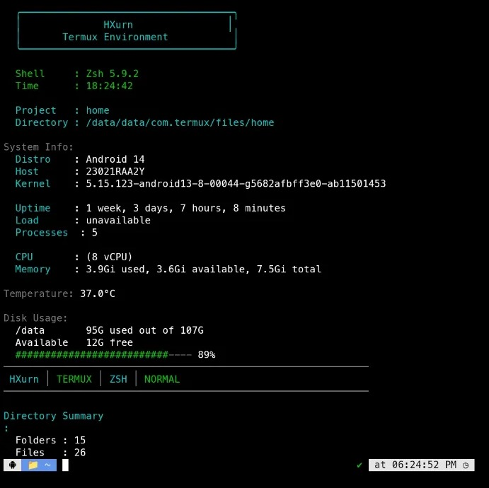

# HXurn

  

  **A lightweight system dashboard for Termux.**

  
  
  

What it does

- Displays Android device information.
- Shows current shell and shell version.
- Displays current project and working directory.
- Shows system uptime and running processes.
- Displays CPU core count.
- Monitors memory usage.
- Displays device temperature.
- Shows storage usage and available space.
- Provides a directory summary.

Installation

1. Install "Termux" (https://github.com/termux/termux-app).

2. Update package lists:
   
   pkg update

3. Install Git:
   
   pkg install git

4. Clone the repository:
   
   git clone https://github.com/HXurn/HXurn.git

5. Enter the project directory:
   
   cd HXurn

6. Run the installer:
   
   bash install.sh

Usage

Run the dashboard with:

bash ~/.config/hxurn/dashboard.sh

Update

Enter the cloned HXurn repository directory and run:

bash update.sh

The updater checks GitHub for the latest dashboard version and backs up the existing dashboard before installing an update.

> Note: The screenshot shows HXurn running in a customized Zsh environment.
> HXurn itself only provides the system dashboard.

License

HXurn is licensed under the GNU General Public License v3.0 (GPL-3.0).

See the "LICENSE" (LICENSE) file for details.

---

  It's getting nippy in here 😂

